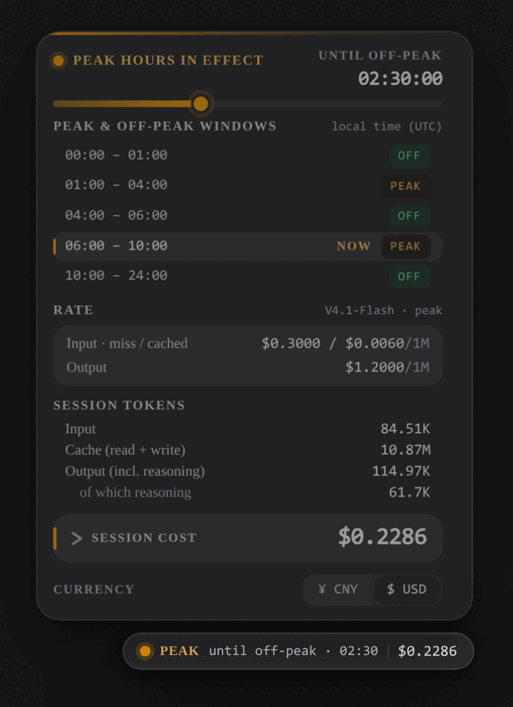
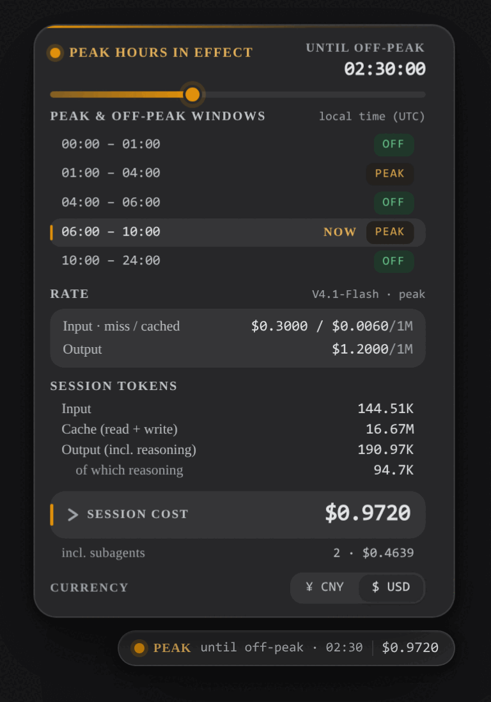
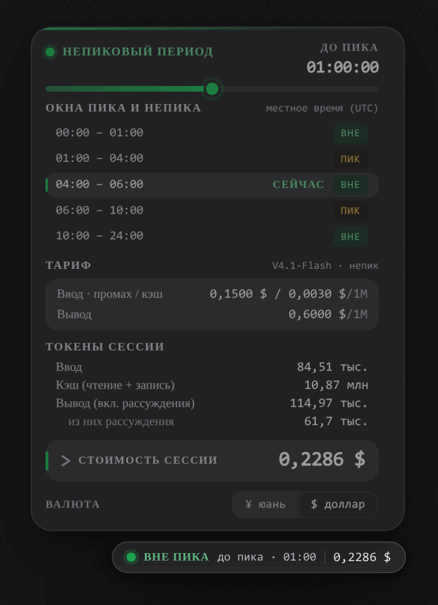
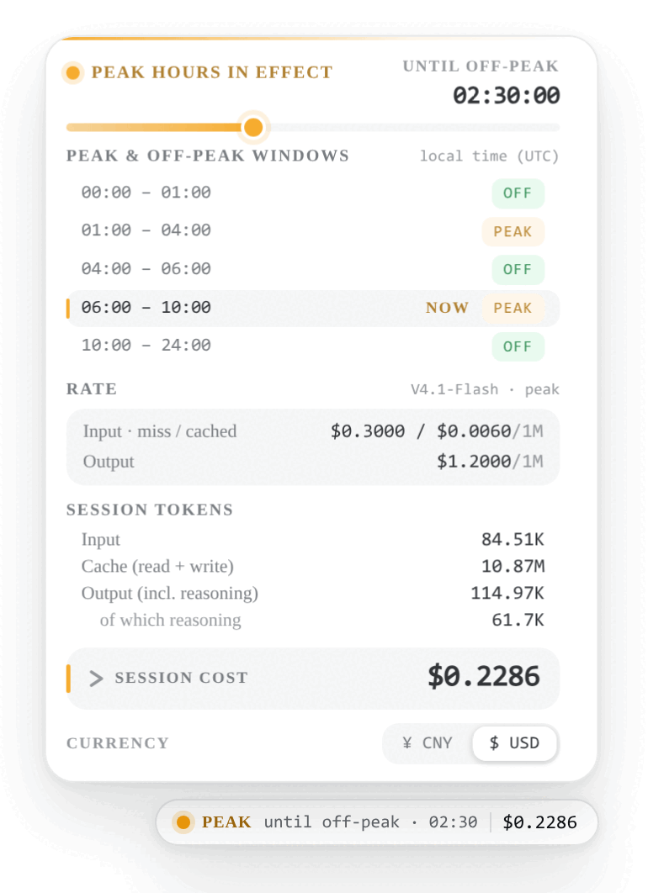

# Napkin Tools: DSH Tidewatch


[](https://t.me/napkincode)
[](https://t.me/writeanynotes)

## [Русская версия](./README-RU.md)

<p align="center">
  
</p>

A floating peak/off-peak **tide gauge** for the DeepSeek Harness web UI. It docks beside the composer and answers three
questions at a glance: which pricing phase is active right now, how long is left in it, and how much this session has
cost.

The card follows the DeepSeek Harness interface language (English, Chinese, Russian), renders the official
peak/off-peak windows in **your own time zone**, and formats money, tokens and clock times with `Intl` for the active
locale.

> This is a fork of [dsh-tidewatch](https://github.com/KhalilYamber/dsh-tidewatch) by KhalilYamber (MIT), reworked for
> international use: a real i18n layer instead of hard-coded Chinese copy, a redesigned card, and a local-time window
> table. The billing math and the session-projection structure come from the original project.

## Table of contents

- [Features](#features)
- [Requirements](#requirements)
- [Install](#install)
  - [Upgrade and uninstall](#upgrade-and-uninstall)
  - [Upgrading from the original 1.x](#upgrading-from-the-original-1x)
- [Usage](#usage)
  - [Scope](#scope)
- [Peak windows](#peak-windows)
- [Billing model](#billing-model)
- [Interface language](#interface-language)
- [Themes and primitives](#themes-and-primitives)
- [Project layout](#project-layout)
- [Data flow](#data-flow)
- [Development and verification](#development-and-verification)
- [Known limitations](#known-limitations)
- [Credits](#credits)
- [Author](#author)
- [Support](#support)
- [License](#license)

## Features

- **Phase at a glance** — an amber (peak) or green (off-peak) state dot with the current phase name and a live
  countdown to the next switch.
- **Tide line** — the header shows how much of the current phase has already elapsed.
- **Window table in your time zone** — the official UTC windows mapped onto your own calendar day, with the current row
  marked; the tier itself is always decided in UTC (the official definition).
- **Weekend rule** — Saturday and Sunday (UTC calendar days) are off-peak all day, so the table collapses into a single
  all-day row.
- **Active tier rates** — cache-miss / cache-hit input prices and the output price per 1M tokens for the phase you are
  in.
- **Session tokens** — input, cache (read + write), output and reasoning, formatted per locale.
- **Per-model cost** — expand the session-cost row to see every model's tokens and cost; the total equals the sum of the
  parts.
- **CNY or USD** — the default follows the interface language (Chinese → CNY, otherwise USD); switching is one click and
  is remembered.
- **Real i18n** — the card follows the DeepSeek Harness language, ships English, Chinese and Russian dictionaries, and
  offers Russian as a selectable language.
- **Shell integration** — reads the `--dsw-*` theme tokens (light and dark) and prefers the official `StateDot`, `Tag`,
  `Tooltip` and `useDismissOnOutsidePointer` primitives, falling back to built-in implementations when a shell does not
  expose them.
- **Keyboard accessible** — the badge and the disclosure rows are real buttons with focus rings, `aria-expanded` /
  `aria-pressed` states and a `progressbar` role on the tide line.

## Requirements

- Node.js ≥ 20.
- DeepSeek Harness with the `dsh plugin` command (a `web` profile).
- Nothing else: the price tables are built in, and the plugin needs no API key or network access of its own.

## Install

> The badge appears in the web UI, so install it into the `web` profile.

```sh
# Option 1: the latest main (recommended; follows the repository)
dsh plugin --profile web add github:proDreams/dsh-tidewatch

# Option 2: a pinned release tag (reproducible installs)
dsh plugin --profile web add github:proDreams/dsh-tidewatch#v2.1.0

# Option 3: the tarball attached to a GitHub Release (pinned and offline-friendly)
dsh plugin --profile web add https://github.com/proDreams/dsh-tidewatch/releases/download/v2.1.0/dsh-tidewatch-2.1.0.tgz

# Local directory (development)
dsh plugin --profile web add link:/path/to/dsh-tidewatch
```

Restart `dsh web` after installing; the tide badge appears to the right of the composer.

> **The npm package `dsh-tidewatch` is not ours.** npm hosts only an old copy published by the original author (1.0.6,
> 2026-08-22) whose prices and rules are outdated, and this fork deliberately stays off npm. Do not install it or judge
> current billing from it — use one of the options above.

### Upgrade and uninstall

```sh
dsh plugin --profile web update dsh-tidewatch    # or re-run the add above
dsh plugin --profile web list dsh-tidewatch      # installed version
dsh plugin --profile web remove dsh-tidewatch    # uninstall
```

See [CHANGELOG.md](CHANGELOG.md) for the release history.

### Upgrading from the original 1.x

**2.0.0** adds the i18n layer, the local-time window table and the redesigned card. Billing itself is unchanged.

Two earlier fixes are worth knowing about if you used the original plugin before 1.1.2:

- **1.1.2 — V4 Pro billing.** The official pricing-page footnote (2) and the 2026-09-10 changelog state that V4 Pro API
  service continues after 2026-09-14 **with its billing method unchanged** (further notice to follow if that changes).
  The earlier build had followed a news-page reading that routed `deepseek-v4-pro` to the Flash price from 2026-09-14
  04:00 UTC, which **understated** pro calls by roughly 4.4× (cache miss), 7.3× (cache hit) and 3.3× (output). The
  repricing boundary `V4_PRO_RETIRE_BOUNDARY` is a sentinel again, so pro always bills on its own rates; the routing
  branch is kept and only needs the date filled in when an official one appears.
- **1.1.1 — three price eras.** Billing now picks the tier from the call's own timestamp, and the `costUsage` projection
  moved to `stateVersion` 4. Persisted sessions replay once after the upgrade, so calls made between 2026-08-16 and
  2026-09-10 are restored to the **first** peak schedule (they had been billed at the newer, lower rates). Live billing
  was never affected.

## Usage

- The badge docks to the right of the composer, vertically centered with it. When the window is too narrow it moves
  above the composer instead, and it never covers the input area or the built-in stats bar.
- Click the badge to expand or collapse the panel: window table, active tier rates, token breakdown and the currency
  switch.
- Click the **Session cost** row to expand the per-model cost breakdown.
- The currency switch applies immediately and persists; CNY shows 2 decimals, USD shows 4.
- The expanded panel never exceeds the free space above the badge — its height budget is measured from the badge itself,
  so it does not cover the composer on a small screen.

### Scope

The card reports the model calls written into the session event stream, and it also rolls up the session's descendant
(subagent) sessions, so a team run shows the cost of the whole task. The token totals and the per-model breakdown include
them too; the subagent share is shown under the total as `incl. subagents N · $X`.

<p align="center">
  
</p>

It does **not** include calls that never enter a session's event stream: experimental **Auto review** (the `Auto`
permission preset reviews every supported tool call with the same model), session title generation, context compaction,
web-search wrappers, and other chats. Those are billed to the account — see Platform → Usage (or a usage-tracking plugin)
for the account-level figure.

## Peak windows

DeepSeek introduced peak/off-peak time-of-day pricing on 2026-08-17:

| Window (UTC) | Beijing time | Tier |
|---|---|---|
| 01:00 – 04:00 | 09:00 – 12:00 | peak |
| 04:00 – 06:00 | 12:00 – 14:00 | off-peak |
| 06:00 – 10:00 | 14:00 – 18:00 | peak |
| 10:00 – next 01:00 | 18:00 – next 09:00 | off-peak |

Off-peak prices are half of the peak prices. The card decides the tier from the **UTC** windows (the official
definition) and renders the table in the viewer's own time zone.

**Weekend rule (since 2026-08-23)**: Saturday and Sunday (UTC calendar days) bill at off-peak prices all day with no
peak/off-peak switch; the next switch lands at the first peak window of the following Monday.

## Billing model

- Unit: USD per 1M tokens (the official pricing-page basis). Cost = input-miss × cacheMiss + output × output +
  (cache-read + cache-write) × cacheHit; "output" already includes reasoning tokens.
- **Three price eras**, selected by the call's own timestamp (historical correctness; tiers are listed as cache-hit /
  cache-miss / output):

  | Era | Range (UTC) | `deepseek-flash` tiers |
  |---|---|---|
  | Base price | before 2026-08-16 16:00 | 0.0028 / 0.14 / 0.28 |
  | First peak schedule | 2026-08-16 16:00 – 2026-09-10 04:00 | peak 0.014 / 0.44 / 1.32, off-peak is half |
  | V4.1 Flash repricing | from 2026-09-10 04:00 | peak 0.006 / 0.3 / 1.2, off-peak is half |

- Every call is billed at the tier of its **event timestamp**, so costs do not drift across a phase switch or a
  repricing.
- The ledger stores USD. The panel displays CNY at the fixed 6.67 rate (which matches the official CNY price list) or
  USD directly.

## Interface language

The card is a normal DeepSeek Harness citizen: it registers the `tidewatch` locale namespace and reads its copy through
the framework translator, so switching the interface language in **Settings → Language** switches the card immediately.

| Language | Status |
|---|---|
| English | shipped (`en`) — the fallback language of the lookup chain |
| Chinese (Simplified) | shipped (`zh`) |
| Russian | shipped (`ru`) and offered to the language catalog by the plugin |

<p align="center">
  
</p>

- DeepSeek Harness ships only `zh` and `en`, so the plugin adds Russian to the language list itself. Other plugins fall
  back to English for that language.
- On a shell without a locale service the card falls back to the browser language instead of defaulting to one
  hard-coded language.
- Copy is never assembled from fragments: every string is a `{placeholder}` template owned by each language, and the
  test suite fails if the dictionaries drift apart.

## Themes and primitives

The card follows the DeepSeek Harness theme through `--dsw-*` variables, and every plugin-local token keeps a
scheme-aware fallback, so it stays correct on a host without the theme layer as well.

- Light and dark are both supported; the phase accent (amber or green) is the only saturated colour.
- Figures use the shell's mono stack with tabular numerals, so the panel reads like an instrument.
- The front end prefers the official shared primitives — `StateDot`, `Tag`, `Tooltip` and
  `useDismissOnOutsidePointer` — and degrades to built-in implementations when the shell's module table does not expose
  them.

<p align="center">
  
</p>

## Project layout

```
dsh-tidewatch
├── package.json          # dsh.bundle.patch + dsh.client.platform manifest
├── cordis.patch.yml      # bundle patch row
├── scripts/build.sh      # build: syntax check + zod junction
├── lib/
│   ├── pricing.js        # pure functions: windows, isPeakHour/peakPhaseAt, three price eras, costOf
│   ├── index.js          # host: costUsage session projection (billed per event time)
│   └── client.js         # browser: floating tide card + i18n dictionaries (__ModuleLoader__ bundle)
├── docs/PORTING.md       # adaptation notes for other hosts
└── test/verify.mjs       # pure-module self-test (node test/verify.mjs)
```

## Data flow

```
model-call usage blocks (assistant/chunk, assistant/message events)
        │  lib/index.js: costUsage session projection (zod-schema validated)
        ▼
  token buckets + USD cost (per-event-time peak/off-peak tier)
        │  useProjection('costUsage') (browser)
        ▼
  lib/client.js: card rendering (per-second countdown, Intl formatting, FX conversion)
```

## Development and verification

```sh
DSH_CHECKOUT=<harness source root> bash scripts/build.sh   # syntax check + zod junction
node test/verify.mjs                                       # 78 checks: peak math, billing, i18n, time zones
```

The suite materializes the real client bundle against a stub React and a fake plugin context, so it exercises the
shipped dictionaries, the fallback chain, locale-aware formatting and the time-zone window table rather than a copy of
them.

## Known limitations

- **Prices are built in** and cover three eras (base price / first peak schedule / V4.1 Flash repricing); V4-Pro uses the
  official 2026-08-17 rates. Per footnote (2) on the official pricing page and the 2026-09-10 changelog, V4 Pro keeps
  being served after 2026-09-14 **with its billing method unchanged**, so pro always bills on its own rates and
  `V4_PRO_RETIRE_BOUNDARY` stays a sentinel pending an official date. **When the official prices change, update both
  `lib/pricing.js` (billing) and the `DISPLAY_PRICES` constant in `lib/client.js` (display) by hand, and keep the
  superseded tiers as another historical era.**
- **Model names**: `deepseek-flash` is current (V4.1 Flash); the aliases `deepseek-v4-flash`,
  `deepseek-v4-flash-vision-exp` and `deepseek-v4.1-flash` are all billed at the current flash rate (see
  `MODEL_ALIASES`).
- **Tier judgement is fixed to UTC** (the official definition); the window table is display-only localization.
- **The CNY display is a fixed-rate conversion** (6.67 USD → CNY, matching the official CNY prices), not a live rate.

## Credits

- Original project: [dsh-tidewatch](https://github.com/KhalilYamber/dsh-tidewatch) by **KhalilYamber** (MIT) — the
  billing math, the price-era model and the session-projection structure.
- Peak/off-peak math and the projection shape are adapted from
  [dsh-cost-meter](https://github.com/Han-1413141/dsh-cost-meter) (MIT), rewritten for a minimal footprint.

## Author

Program author: Ivan Ashikhmin
Telegram for contact: [https://t.me/proDreams](https://t.me/proDreams)

The program was created as part of the "Code on a Napkin" project.

- Website: [https://pressanybutton.ru/](https://pressanybutton.ru/)
- Telegram channel: [https://t.me/napkincode](https://t.me/napkincode)

## Support

If you like this project and want to support its further development, consider donating:

- [Support via YooMoney](https://yoomoney.ru/to/41001431694461)
- [Support via Tribute in Telegram](https://t.me/tribute/app?startapp=dyds)
- [Support via our Telegram bot](https://t.me/napkincode_bot?start=donate)

Your support helps the project grow and improve future features!

## License

This project is licensed under the MIT License. It is a derivative of dsh-tidewatch by KhalilYamber; both copyright
notices are retained in the [LICENSE](LICENSE) file.
